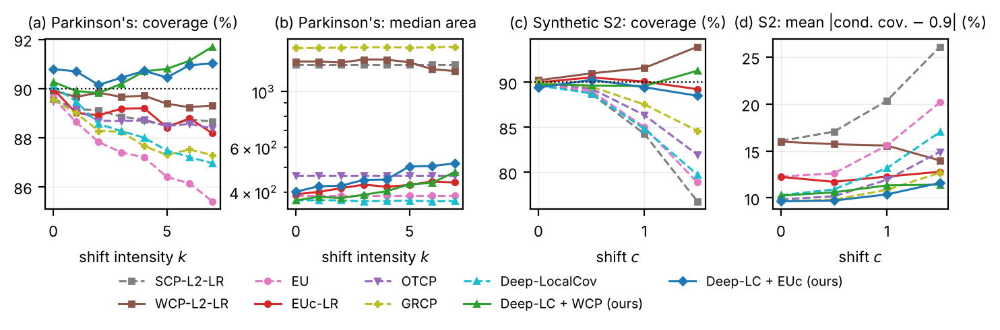

# Shift-Robust Prediction Regions for Multiple Outcomes

**Distribution-free uncertainty quantification for multivariate regression when the test population differs from the training population.**

Umma Hafsah Himu · uhimu1@student.gsu.edu



*Left: Parkinson's data under a covariate shift of increasing strength k. Right: synthetic data with heteroskedastic noise. Solid lines are shift-corrected methods; the dotted line is the 90% target.*

## The problem

Many predictions involve several correlated outcomes at once. In Parkinson's telemonitoring, for example, a model predicts two clinical scores (motor and total UPDRS) from voice recordings, and a clinician needs a *region* that contains both true scores with a guaranteed probability, say 90%.

Conformal prediction gives such guarantees without distributional assumptions, but two problems arise in practice:

1. **One size does not fit all.** A region with the same shape for every patient is too wide for some and too narrow for others.
2. **Populations shift.** When the model is used on a population that differs from the training data (*covariate shift*), the guarantee breaks. Coverage can drop from 90% to 85% or lower.

Existing methods solve one problem or the other. This project solves both together.

## What I built

- A **PyTorch neural network** that predicts the mean of both outcomes *and* an input-dependent covariance (Cholesky parameterization, Gaussian likelihood loss), so each prediction region is an ellipse whose size, shape and orientation adapt to the input.
- **Two shift-robust calibration methods** for this network:
  - **Deep-LC + WCP**: density-ratio-weighted conformal calibration, with weight clipping for stability.
  - **Deep-LC + EUc**: a shift-corrected Euclidean-likelihood score with bootstrap calibration.
- A **benchmark of 11 methods**, including optimal-transport and spatial-rank conformal regions, on real and synthetic data, with 20 random splits per setting and paired significance tests.
- A **finite-sample coverage analysis** explaining when re-weighting is needed and when it is not (manuscript in preparation).

## Key results

Target coverage is 90%; all numbers are averages over 20 random splits.

| Finding | Evidence |
|---|---|
| Under the strongest shift on the Parkinson's data, both proposed methods stay at the 90% target; the unweighted methods fall to 85–89%. | Deep-LC + WCP **90.1%**, Deep-LC + EUc **90.1%**; Euclidean likelihood (EU) 85.4%, the deep network without correction 87.0% (`results/weighted_baselines_clip99/`) |
| Weight clipping removes unbounded regions and numerical failures caused by extreme weights. | Unbounded regions 12.2% → 0% in the hardest setting, coverage 92.5% → 90.5% under shift (`results/ratio_ablation/`) |
| With heteroskedastic noise, the regions are about **3× smaller** than those of the shift-corrected Euclidean-likelihood method at similar coverage, with the lowest conditional-coverage error. | Synthetic scenario S2, true conditional coverage known (`results/synthetic/`) |
| With repeated measurements, calibration must be grouped by patient. Calibrating on the same patients used for fitting made **every** method under-cover badly on new patients (64–83%); patient-grouped calibration restored 87–90% for most methods. | `results/patient_shift/` vs `results/patient_shift_grouped/` |

Parkinson's data, strongest shift (k = 7), clipped weights, 20 splits (`results/weighted_baselines_clip99/table_main.csv`):

| Method | Coverage (%) | Median region area | Unbounded regions (%) |
|---|---|---|---|
| EU (no shift correction) | 85.41 | 387 | 0 |
| Deep-LC (no shift correction) | 86.96 | 368 | 0 |
| EUc-LR (Gan & Liu, shift-corrected) | 87.36 | 424 | 0 |
| OTCP + WCP | 89.18 | 489 | 0 |
| GRCP + WCP | 88.94 | 1664 | 0 |
| **Deep-LC + WCP (this project)** | **90.06** | **437** | 0 |
| **Deep-LC + EUc (this project)** | **90.12** | 505 | 0 |

**Where the approach does not help** (reported honestly):
- With a correct linear model and constant noise, linear methods give smaller regions.
- Shifts between patient groups that change the outcome–input relationship itself (not only the inputs) are not corrected by any method tested.
- With the clipped weights, the proposed methods match, but do not significantly beat, a weighted optimal-transport baseline.

## Skills demonstrated

- **Machine learning:** PyTorch network design and training (custom likelihood loss, Cholesky output head, early stopping), GPU training.
- **Statistics:** conformal prediction, covariate shift and density-ratio estimation (logistic regression, clipping), bootstrap and jackknife calibration, paired t-tests, coverage diagnostics (worst-slab coverage, cluster-conditional error), effective sample size.
- **Experimental design:** 11-method benchmark, synthetic data with known ground truth, ablation studies, leakage detection (patient-level grouping).
- **Reproducible research:** modular Python package (`src/`), numbered notebooks with a quick-test mode, fixed seeds, every result written to its own folder, version control with Git.

## Methods compared

| Method | Idea | Source |
|---|---|---|
| SCP-L2-LR / WCP-L2-LR | Euclidean-norm residual of linear regression, unweighted / weighted | Lei et al. (2018); Tibshirani et al. (2019) |
| EU / EUc-LR | Euclidean-likelihood ellipse, without / with shift correction | Gan & Liu (2025) |
| OTCP / OTCP + WCP | optimal-transport ranks of residuals | Klein et al. (2026) |
| GRCP / GRCP + WCP | conditional spatial ranks | Conrad et al. (2026) |
| Deep-LC | learned local-covariance (Mahalanobis) score | Braun et al. (2026) |
| **Deep-LC + WCP** | Deep-LC with weighted calibration | **this project** |
| **Deep-LC + EUc** | shift-corrected Euclidean likelihood on whitened residuals | **this project** |

Data: Parkinson's telemonitoring (UCI; 5,875 recordings from 42 patients), Energy Efficiency and Bias Correction (UCI), and two synthetic designs with known conditional coverage.

## Repository layout

```
.
├── src/
│   ├── deep.py            mean + local-covariance network (PyTorch)
│   ├── cpshift.py         conformal methods, density ratios, metrics (NumPy)
│   ├── otgeo.py           optimal-transport and spatial-rank baselines
│   └── experiment.py      shared experiment loop
├── notebooks/             one notebook per experiment (see table below)
├── results/               result tables (.csv), one folder per experiment
├── figures/               main figures
├── data/                  datasets go here (not tracked; see data/README.md)
└── requirements.txt
```

| Notebook | Experiment | Results folder |
|---|---|---|
| 01_exchangeable_baselines | no shift; reproduces Gan & Liu (2025) | `exchangeable/` (created when run) |
| 02_covariate_shift | shift of increasing strength + ablations | `covariate_shift/` (created when run) |
| 03_synthetic | synthetic data, true conditional coverage | `synthetic/` |
| 04_benchmark_parkinsons | original Parkinson's benchmark | `benchmark_parkinsons/` |
| 05_other_datasets | Energy Efficiency and Bias Correction data | `other_datasets/` |
| 06_weighted_baselines | all 11 methods, Parkinson's | `weighted_baselines/`, `weighted_baselines_clip99/` |
| 07_patient_shift | train and test on different patients | `patient_shift/`, `patient_shift_grouped/` |
| 08_ratio_ablation | density-ratio estimators, weight clipping | `ratio_ablation/` |

Two notebook settings select variants of the same code:
- `RATIO_CLIP = 0.99` gives the main results with clipped weights (folders ending in `_clip99`); `None` gives the original runs.
- `GROUPED_CAL = True` (notebook 07) gives patient-grouped calibration (`patient_shift_grouped/`); `False` gives the record-level run (`patient_shift/`).

## How to reproduce

1. Python 3.12: `pip install -r requirements.txt` (for a GPU, install the CUDA build of PyTorch from https://pytorch.org).
2. Put the Parkinson's data in `data/` (see `data/README.md`). Notebook 05 downloads its two data sets from UCI automatically.
3. Open a notebook and run all cells. `QUICK = True` checks the code in a few minutes; `QUICK = False` runs the full experiment (20 splits; about 1–2 hours per notebook on an RTX A2000 laptop GPU).
4. Tables and figures are written to the notebook's folder in `results/`.

## References

- Braun, S., Berta, E., Jordan, M. I. & Bach, F. (2026). Multivariate standardized residuals for conformal prediction. arXiv:2507.20941.
- Conrad, A., Moulines, E. & Perez, J. (2026). Geometric conformal prediction with spatial ranks and multivariate quantiles. ICML.
- Gan, F. & Liu, Y. (2025). Conformal prediction for multivariate responses with Euclidean likelihood. *Journal of Multivariate Analysis* 210:105494.
- Klein, M., Bethune, L., Ndiaye, E. & Cuturi, M. (2026). Multivariate conformal prediction using optimal transport.
- Lei, J., G'Sell, M., Rinaldo, A., Tibshirani, R. J. & Wasserman, L. (2018). Distribution-free predictive inference for regression. *JASA* 113:1094–1111.
- Tibshirani, R. J., Barber, R. F., Candès, E. J. & Ramdas, A. (2019). Conformal prediction under covariate shift. NeurIPS.
- Tsanas, A., Little, M., McSharry, P. & Ramig, L. (2009). Accurate telemonitoring of Parkinson's disease progression by non-invasive speech tests.

## Status

Research code accompanying a manuscript in preparation. Results tables in `results/` were produced on an RTX A2000 laptop GPU; notebooks are saved without outputs and regenerate all tables when run.
